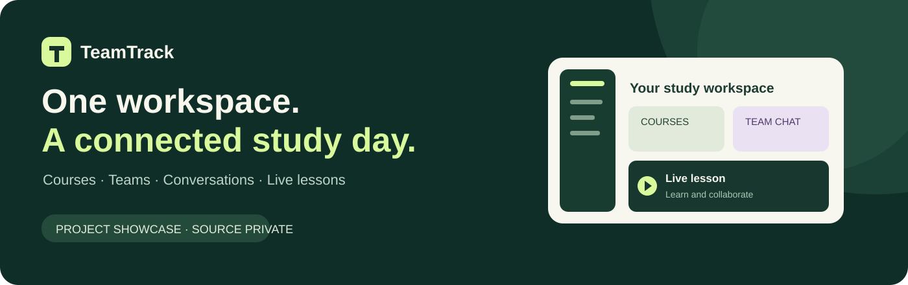

  

# TeamTrack

**En arbetsyta för kurser, team och digitala lektioner.**

[English](README.md) · [Utvecklarprofil](https://github.com/Manne-92)

TeamTrack samlar studiearbetet i en arbetsyta: kursinformation, teamuppgifter, samtal, delade filer och digitala lektioner. En student kan navigera på webbplatsen samtidigt som samtalet finns kvar i arbetsytan.

**Skapat av Mahmoud Halbia · Studentprojekt inom Fullstack .NET**

Detta är ett **offentligt portföljrepo**. Applikationens implementation hålls separat i ett privat repo. Här finns ingen applikationskällkod, databasexport, användaruppladdning eller tjänstenyckel.

## Funktioner

| Område | Innehåll |
| --- | --- |
| Kurser | Kursinformation, medlemskap och lektionsmaterial |
| Team | Gruppmedlemskap, inbjudningar och en tavla för studieuppgifter |
| Konversationer | Kurs- och teamchattar, filer, svar, reaktioner och omnämnanden |
| Digitala lektioner | Lärarledda möten, skärmdelning och deltagarkontroller |
| Övningsrum | Gruppövningar med timer och återgång till huvudlektionen |
| Arbetsyta | Navigering under pågående samtal och möjlighet att öppna samtalsvyn igen |
| Profiler | Profilbild, initialer när bild saknas och visuell rollskillnad |
| Språk | Svenskt och engelskt gränssnitt |

## Ett sammanhängande studieflöde

1. **Hitta din kurs.** Öppna kursen och dagens lektionsinformation.
2. **Arbeta med ditt team.** Följ upp uppgifter, skriv meddelanden och dela material.
3. **Delta i lektionen.** Använd ljud, kamera eller skärmdelning enligt mötets behörigheter.
4. **Fortsätt arbeta.** Navigera i arbetsytan medan samtalet finns kvar.
5. **Återvänd till materialet.** Läs lektionsinformationen och öppna tillhörande resurser.

Läraren har andra möteskontroller än studenter och inbjudna gäster. Kontots globala roll, ansvaret för en kurs och deltagandet i ett visst möte är olika begrepp i implementationen.

## Teknisk översikt

| Lager | Teknik |
| --- | --- |
| Applikation | C# och ASP.NET Core MVC på .NET 10 |
| Konton | ASP.NET Core Identity |
| Data | Entity Framework Core och SQLite |
| Gränssnitt | Razor-vyer, CSS och JavaScript |
| Realtidsmedia | LiveKit |
| Medieproxy | YARP |
| Automatiserade kontroller | xUnit och integrationstester |

Projektet visar bland annat serverbaserade åtkomstkontroller, relationsmodellering, separation mellan filmetadata och filinnehåll, återanvändbara gränssnittskomponenter och samordning mellan arbetsytan och samtalskontrollerna.

## Utvecklingsstatus

TeamTrack är ett fungerande studentprojekt under utveckling, inte en certifierad produktionstjänst. Automatiserade tester täcker utvalda åtkomstregler och applikationsflöden. Media mellan riktiga enheter, e-postleverans och produktionsmiljön behöver kontrolleras i sina respektive miljöer.

**Lektionsinspelning är förberedd men ännu inte aktiv.** Lärarens alternativ och tjänstegränssnittet finns. Egress-adaptern, lagringen och flödet för att färdigställa inspelningen behöver fortfarande kopplas in innan videor kan skapas eller sparas automatiskt.

## Integritet och källkod

Här visas utvald produktinformation och en övergripande teknisk beskrivning. Databasens fullständiga modell, implementationen och konfigurationen hålls utanför detta repo. Tjänstenycklar och riktiga användaruppgifter hör inte hemma i ett repo, inte heller i ett privat.

En privat serverimplementation gör inte webbplatsens levererade webbläsarfiler osynliga. Besökare kan inspektera HTML, CSS och JavaScript på en publicerad webbplats.

## Redovisning eller demonstration

En lärare eller granskare kan diskutera en demonstration och eventuell åtkomst till den privata källkoden med författaren. Inga offentliga demoinloggningar eller produktionsadresser publiceras här.

[Mahmoud Halbia på GitHub](https://github.com/Manne-92)

## Projektets material

Detta är en presentation, inte en publicering av applikationen som öppen källkod. Tredjepartskomponenter behåller sina respektive licenser. Omslagsbilden är en portföljillustration och inte en skärmbild från det körande systemet.
